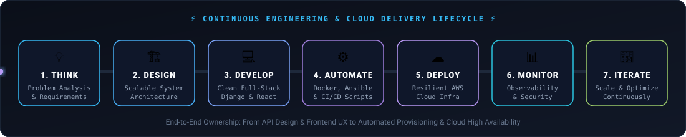
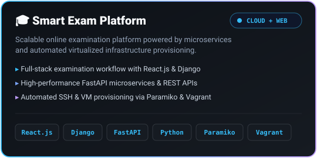
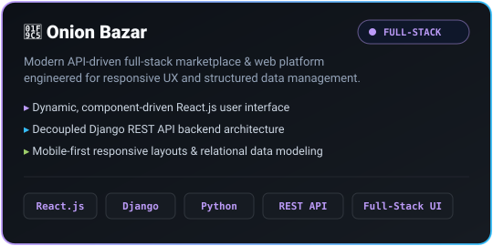
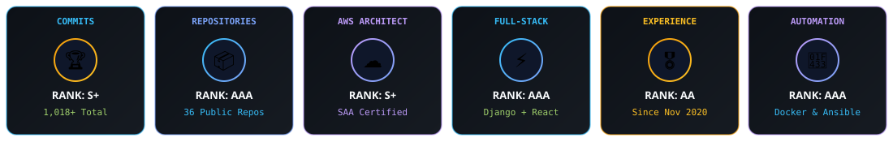
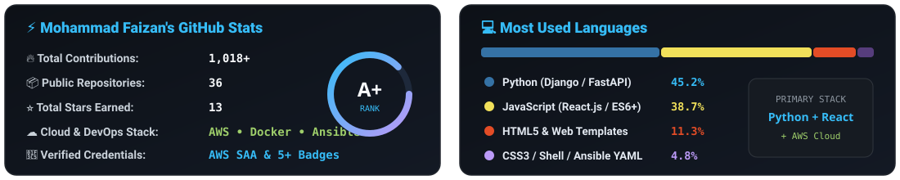
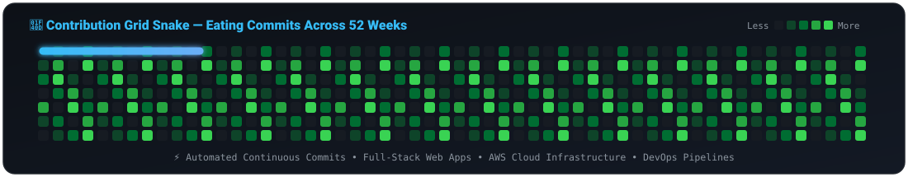

<!-- ===================================================================== -->
<!--                     MOHAMMAD FAIZAN QURESHI                           -->
<!--           Animated • High-Impact • Cloud & Full-Stack README          -->
<!-- ===================================================================== -->

  

<!-- Live Profile Telemetry & Social Badges -->

  
  
  
  
  
  

  

<!-- ===================================================================== -->
<!--                          ABOUT ME & TERMINAL                          -->
<!-- ===================================================================== -->

## ⚡ `whoami` — System & Developer Telemetry

  

I'm **Mohammad Faizan Qureshi**, a **Full-Stack Developer & Cloud Engineer** based in **Nashik, Maharashtra, India**, passionate about designing, developing, deploying, and automating modern software systems.

I work across the **complete engineering lifecycle** — from crafting high-performance backend APIs and responsive React interfaces to provisioning cloud-native environments on **AWS** with **Docker, Linux, and Ansible**.

### 🎯 Core Engineering Pillars

- 💻 **Full-Stack Web Engineering** — End-to-end web platforms built with **Python, Django, FastAPI & React.js**
- ☁️ **Cloud Architecture (AWS)** — Designing resilient, cost-optimized, and high-availability cloud workloads
- ⚙️ **DevOps & Infrastructure Automation** — Eliminating manual toil via **Ansible, Docker, Vagrant & Bash**
- 🔐 **Production Reliability & Security** — Hardening Linux servers, Nginx reverse proxies, and API ecosystems

 

  

<!-- ===================================================================== -->
<!--                  ENGINEERING MINDSET & PIPELINE                       -->
<!-- ===================================================================== -->

## 🧠 Engineering Mindset & Delivery Pipeline

  

  

<!-- ===================================================================== -->
<!--                        TECH STACK ARSENAL                             -->
<!-- ===================================================================== -->

## 🛠️ Technology Arsenal

| Domain | Core Technologies & Ecosystem |
| :--- | :---: |
| **🐍 Backend & APIs** |      |
| **⚛️ Frontend & UI** |      |
| **☁️ Cloud & DevOps** |        |
| **🔧 Developer Workflow** |      |

  

<!-- ===================================================================== -->
<!--                       WHAT I LIKE BUILDING                            -->
<!-- ===================================================================== -->

## 🏗️ Architectural Focus Areas

<table align="center" width="100%">
  <tr>
    <td align="center" width="33%">
      <h3>🌐 Scalable Web Apps</h3>
      Responsive React frontends backed by modular Django &amp; FastAPI services engineered for speed and clarity.
    </td>
    <td align="center" width="33%">
      <h3>☁️ Cloud Infrastructure</h3>
      Fault-tolerant AWS deployments designed around high availability, security groups, and clean networking.
    </td>
    <td align="center" width="33%">
      <h3>⚙️ Zero-Touch Automation</h3>
      Infrastructure-as-Code workflows with Ansible, Paramiko, Vagrant, and Bash to eliminate manual setup.
    </td>
  </tr>
  <tr>
    <td align="center" width="33%">
      <h3>🐳 Containerized Systems</h3>
      Reproducible Docker environments that guarantee parity from local development to cloud production.
    </td>
    <td align="center" width="33%">
      <h3>🔌 API-First Architecture</h3>
      Clean, documented RESTful services designed for seamless frontend, mobile, and third-party integration.
    </td>
    <td align="center" width="33%">
      <h3>🔐 Reliability &amp; Security</h3>
      Hardened Linux environments, automated health checks, and maintainable codebases built to last.
    </td>
  </tr>
</table>

  

<!-- ===================================================================== -->
<!--                         FEATURED PROJECTS                             -->
<!-- ===================================================================== -->

## 🚀 Featured Engineering Projects

  <i>Flagship full-stack &amp; cloud automation systems designed and built from the ground up.</i>

<table align="center" width="100%">
  <tr>
    <td width="50%" align="center" valign="top">
      
    </td>
    <td width="50%" align="center" valign="top">
      
    </td>
  </tr>
</table>

  

  

<!-- ===================================================================== -->
<!--                CERTIFICATIONS & VERIFIED CREDENTIALS                  -->
<!-- ===================================================================== -->

## 🏅 Certifications & Verified Credentials

<table align="center" width="100%">
  <tr>
    <th width="50%" align="center">☁️ Amazon Web Services (AWS)</th>
    <th width="50%" align="center">🛠️ Server Infrastructure &amp; Open Source</th>
  </tr>
  <tr>
    <td align="center" valign="middle">
       
      
        
      
      
        
    </td>
    <td align="center" valign="middle">
       
      
      
        
      
        
    </td>
  </tr>
</table>

  

  
  &nbsp;
  

  

<!-- ===================================================================== -->
<!--                    GITHUB ANALYTICS & TELEMETRY                       -->
<!-- ===================================================================== -->

## 📊 GitHub Analytics & Contribution Telemetry

  

  

  

  

  

  

<!-- ===================================================================== -->
<!--                      DEVELOPER QUOTE & CONNECT                        -->
<!-- ===================================================================== -->

## 💡 Engineering Quote of the Day

  

## 📫 Let's Connect & Build Together

  <i>Open to exciting Full-Stack, Cloud Engineering, and DevOps opportunities &amp; collaborations!</i>

  
  
  
  

<!-- Animated Footer Wave -->

  

  <b>⭐ If you find my projects or infrastructure setups useful, consider starring a repository!</b>

